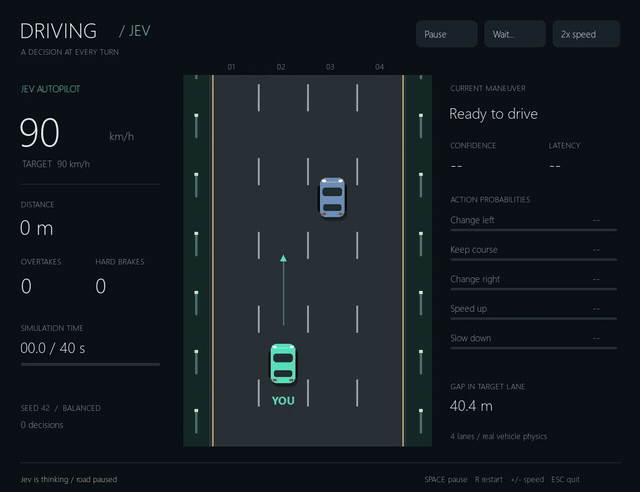
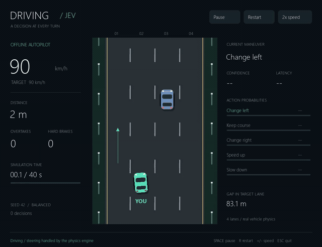
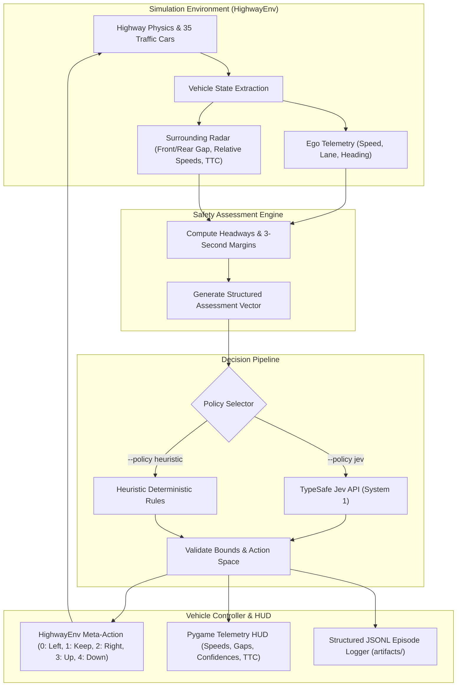

# ️ JEVDrive: Autonomous Highway AI Driving Simulation

[](https://www.python.org/)
[](LICENSE)
[](https://pyga.me/)
[](https://highway-env.farama.org/)
[](https://github.com/typesafe-ai)
[](https://github.com/astral-sh/ruff)
[](tests/)

> **JEVDrive** is a real-time autonomous highway driving decision system that couples **TypeSafe Jev AI** with a high-fidelity **HighwayEnv** physics engine and a custom **Pygame Cockpit Telemetry HUD**. It demonstrates cognitive decision-making (lane changing, headway pacing, speed modulation, and obstacle avoidance) under dense multi-vehicle highway traffic.

---

## Table of Contents
- [ Key Highlights](#-key-highlights)
- [ Visual Showcase & Live Previews](#-visual-showcase--live-previews)
- [ Autonomous Driving Engines](#-autonomous-driving-engines)
  - [1. TypeSafe Jev (Live AI Decision Engine)](#1-typesafe-jev-live-ai-decision-engine)
  - [2. Heuristic Rule-Based Policy (Offline Engine)](#2-heuristic-rule-based-policy-offline-engine)
- [️ System Architecture](#️-system-architecture)
- [ Cockpit Telemetry HUD Explained](#-cockpit-telemetry-hud-explained)
- [ Mathematical & Safety Formulation](#-mathematical--safety-formulation)
- [ Quickstart & Installation](#-quickstart--installation)
  - [Prerequisites](#prerequisites)
  - [Step-by-Step Setup](#step-by-step-setup)
- [ Running the Simulation](#-running-the-simulation)
  - [Interactive Execution](#interactive-execution)
  - [Headless Benchmarking Mode](#headless-benchmarking-mode)
  - [CLI Reference](#cli-reference)
- [️ Controls & Keybindings](#️-controls--keybindings)
- [ Project Directory Structure](#-project-directory-structure)
- [ Testing & Quality Assurance](#-testing--quality-assurance)
- [ Telemetry Logging & Data Collection](#-telemetry-logging--data-collection)
- [ License](#-license)
- [ Acknowledgments](#-acknowledgments)

---

## Key Highlights

- **Dual Policy Architecture**: Switch seamlessly between real-time cognitive reasoning via the **TypeSafe Jev API** and deterministic, low-latency **Heuristic** algorithms.
- **Physics-Grounded Simulation**: Built on Farama's `HighwayEnv` 1.12.1, incorporating realistic vehicle kinematics, multi-lane roadway bounds, and Intelligent Driver Model (IDM) traffic agents.
- **Fair Latency Physics Guarantee**: The simulation automatically freezes roadway physics during in-flight LLM calls, ensuring network latency does not compromise vehicle safety or reaction time.
- **Cockpit Telemetry HUD (60 FPS)**: Custom 2D vertical perspective renderer featuring real-time speedometers, target speeds, lane clearances, TTC (Time-To-Collision) indicators, model confidence meters, and action probability distributions.
- **Quantitative Performance Tracking**: Records total distance traveled, successful vehicle overtakes, hard braking incidents ($a < -4.0\ \text{m/s}^2$), and lane transitions in structured JSONL episode traces.
- **Multi-Speed & Interactive Controls**: On-the-fly toggling between 1x, 2x, and 4x simulation speeds, live pause/resume, and instant seed reset.

---

## Visual Showcase & Live Previews

Both runs below share an identical initial traffic distribution (**Seed 42**) across a 40-second simulation window at 2x simulation speed. Click any preview GIF to watch the complete, high-resolution MP4 video.

|  TypeSafe Jev (Cognitive AI Decision Engine) |  Offline Heuristic (Rule-Based Engine) |
| :---: | :---: |
| [](media/jev.mp4) | [](media/offline.mp4) |
| **Real-time API Reasoning** · [Full Video (MP4)](media/jev.mp4) · [Screenshot](media/jev.png) | **Deterministic Heuristic** · [Full Video (MP4)](media/offline.mp4) · [Screenshot](media/offline.png) |

---

## Autonomous Driving Engines

JEVDrive implements two distinct driving intelligence policies:

### 1. TypeSafe Jev (Live AI Decision Engine)
The Jev driver uses the `typesafe-sdk` client to submit structured situational assessments directly to the TypeSafe AI model using `System 1` cognition:
- **Assessment Vector**: Before each decision, JEVDrive computes time-to-collision (TTC) for all 4 lanes, projected 3-second headway at current velocities, lead car speed differences, and clearance gains.
- **Action Selection**: Selects one of five discrete maneuvers: `Change left`, `Keep course`, `Change right`, `Speed up`, or `Slow down`.
- **Probabilities & Confidence**: The model returns full action probability distributions and confidence scores, rendered live on the HUD.

### 2. Heuristic Rule-Based Policy (Offline Engine)
For benchmarking and offline play without requiring an API key:
- **Balanced Style**: Target cruise speed of **108 km/h (30 m/s)** with aggressive passing of slower lead vehicles when adjacent lane gaps permit.
- **Cautious Style**: Target cruise speed of **90 km/h (25 m/s)** with conservative safety margins (2.5s headway) and early deceleration.

---

## ️ System Architecture



---

## Cockpit Telemetry HUD Explained

The Pygame cockpit HUD renders real-time performance indicators designed after contemporary avionics and autonomous drive telemetry:

```
┌─────────────────────────────────────────────────────────────┐
│ SPEED:  104.2 km/h  [ TARGET: 108.0 km/h ]    DECISIONS: 28 │
│ DIST:   1,124.6 m   OVERTAKES: 8              TIME: 14.2s   │
│ BRAKES: 1 event     POLICY: Jev (System 1)    STATUS: ACTIVE│
├─────────────────────────────────────────────────────────────┤
│ ACTION SELECTED:  Change Left (p = 0.84)      CONF: 92.4%   │
│ LATENCY:          142 ms                      SEED: 42      │
├─────────────────────────────────────────────────────────────┤
│ LANE STATUS:                                                │
│ Lane 1: Gap 48.2m | Rel Speed: +4.2 km/h | Headway: 2.1s    │
│ Lane 2: [EGO] Gap 18.4m | Closing: -8.1 km/h | TTC: 4.2s ️ │
│ Lane 3: Gap 62.0m | Rel Speed: +12.0 km/h | Headway: 2.8s   │
│ Lane 4: Gap --    | Clearance Clear                         │
└─────────────────────────────────────────────────────────────┘
```

- **Top Bar**: Vehicle current speed, target speed index, total distance traveled, and completed overtakes.
- **Action & Confidence Gauge**: Bar meters detailing the chosen maneuver and relative probabilities assigned by Jev.
- **Latency Monitor**: Real-time roundtrip API response latency in milliseconds.
- **Road Display**: 2D vertical perspective with continuous coordinate scaling. The ego car is highlighted in distinct neon green.

---

## Mathematical & Safety Formulation

JEVDrive enforces rigorous mathematical headway and collision constraints:

1. **Headway Calculation**:
   $$\text{Headway}_t = \frac{\Delta x_{\text{front}}}{v_{\text{ego}}}$$
   - *Preferred Headway Threshold*: $2.0\text{s}$ (Balanced), $2.5\text{s}$ (Cautious).

2. **Time-To-Collision (TTC)**:
   For lead vehicle speed $v_{\text{lead}} < v_{\text{ego}}$:
   $$\text{TTC} = \frac{\Delta x_{\text{front}}}{v_{\text{ego}} - v_{\text{lead}}}$$
   - An early deceleration trigger is activated when $\text{TTC} < 6.0\text{s}$.
   - Rear vehicle warning triggers when $\text{TTC}_{\text{rear}} < 3.0\text{s}$.

3. **Hard Braking Invariant**:
   A hard braking incident is registered whenever deceleration exceeds:
   $$a_{\text{ego}} < -4.0\ \text{m/s}^2$$

---

## Quickstart & Installation

### Prerequisites
- **Operating System**: Windows 10/11, Linux, or macOS.
- **Python**: Version `3.13` or higher.
- **Package Manager**: [uv](https://github.com/astral-sh/uv) (recommended) or standard `pip`.

### Step-by-Step Setup

1. **Clone the Repository**:
   ```powershell
   git clone https://github.com/hasim2006/JEVDrive.git
   cd JEVDrive
   ```

2. **Create and Activate Virtual Environment**:
   Using `uv` (ultra fast):
   ```powershell
   uv venv --python 3.13 .venv
   .venv\Scripts\activate
   ```
   *Or using standard Python:*
   ```powershell
   python -m venv .venv
   .venv\Scripts\activate
   ```

3. **Install Dependencies**:
   ```powershell
   uv pip install -e ".[dev]"
   # Or with pip:
   pip install -e ".[dev]"
   ```

4. **Configure API Credentials**:
   Copy the example environment template and add your TypeSafe API key:
   ```powershell
   Copy-Item .env.example .env
   ```
   Open `.env` in any text editor and supply your key:
   ```env
   TYPESAFE_API_KEY=your_typesafe_api_key_here
   ```
   *(Note: If running in offline heuristic mode `--policy heuristic`, an API key is not required).*

---

## Running the Simulation

### Interactive Execution

**Option A: 1-Click Windows Launchers**:
- Double-click or execute `play.cmd` to start the live TypeSafe Jev driver.
- Double-click or execute `play-offline.cmd` to launch the offline heuristic driver.

**Option B: Command Line**:
```powershell
# Run with TypeSafe Jev AI (Live API)
python -m driving_jev.app

# Run with Rule-Based Heuristic (Offline)
python -m driving_jev.app --policy heuristic

# Run Cautious Driving Style (Lower cruising speed, larger gaps)
python -m driving_jev.app --policy heuristic --style cautious

# Custom Traffic Seed and Extended Duration
python -m driving_jev.app --seed 123 --duration 60
```

### Headless Benchmarking Mode
Run simulations without opening a GUI window for rapid statistical evaluation:
```powershell
# Benchmark Heuristic policy across 40 simulation seconds
python -m driving_jev.app --headless --policy heuristic --seed 42 --duration 40

# Benchmark TypeSafe Jev policy
python -m driving_jev.app --headless --policy jev --seed 42 --duration 40
```

### CLI Reference

| Flag | Type | Default | Description |
| :--- | :--- | :--- | :--- |
| `--policy` | `str` | `jev` | Choice of policy: `jev` (live AI) or `heuristic` (offline). |
| `--style` | `str` | `balanced` | Driving temperament: `balanced` (108 km/h) or `cautious` (90 km/h). |
| `--seed` | `int` | `42` | Pseudorandom seed initializing traffic positions and behaviors. |
| `--duration`| `int` | `40` | Duration of the run in simulation seconds (up to 40 decisions). |
| `--paused` | `flag`| `False` | Starts the simulation window in paused state without firing API calls. |
| `--headless`| `flag`| `False` | Disables Pygame window rendering for automated benchmarking. |

---

## ️ Controls & Keybindings

| Key | Action | Description |
| :---: | :--- | :--- |
| `Space` | **Pause / Resume** | Freezes/unfreezes simulation physics and decision cycles. |
| `R` | **Restart** | Resets the run with the identical initial traffic seed. |
| `+` / `=` | **Speed Up** | Cycles simulation playback speed: **1x → 2x → 4x**. |
| `-` | **Speed Down** | Decreases playback speed down to **1x**. |
| `Esc` / `Q`| **Quit** | Gracefully flushes telemetry logs to disk and closes window. |

---

## Project Directory Structure

```text
JEVDrive/
├── .env.example              # Template for API credentials
├── .gitignore                # Production ignore rules (excludes .venv, artifacts, cache)
├── LICENSE                   # MIT License
├── README.md                 # Project documentation & visual guide
├── README.ko.md              # Korean localization documentation
├── play.cmd                  # Windows 1-click launcher (Live Jev AI)
├── play-offline.cmd          # Windows 1-click launcher (Heuristic mode)
├── pyproject.toml            # Hatchling build specification & dependencies
├── media/                    # Media assets, animations, and documentation videos
│   ├── jev-preview.gif       # Preview animation: TypeSafe Jev AI
│   ├── jev.mp4               # High-res video: TypeSafe Jev AI run
│   ├── jev.png               # High-res capture: Jev decision HUD
│   ├── offline-preview.gif   # Preview animation: Heuristic rule-based driver
│   ├── offline.mp4           # High-res video: Heuristic run
│   └── offline.png           # High-res capture: Heuristic HUD
├── src/
│   └── driving_jev/
│       ├── __init__.py       # Package definition & exports
│       ├── app.py            # Pygame GUI, HUD, async worker, event loops
│       ├── engine.py         # HighwayEnv wrapper, headway math, telemetry
│       └── policy.py         # TypeSafe Jev client & heuristic decision rules
└── tests/
    ├── test_driving.py       # Engine mechanics, action boundaries, TTC logic tests
    └── test_window.py        # Pygame window lifecycle and headless rendering tests
```

---

## Testing & Quality Assurance

JEVDrive is tested using `pytest` and linted with `ruff`:

```powershell
# Run comprehensive test suite
pytest -v

# Run linting and code style checks
ruff check src tests

# Check code formatting
ruff format --check src tests
```

---

## Telemetry Logging & Data Collection

Every episode automatically writes structured telemetry records into `artifacts/run-<timestamp>.jsonl`:
- **Start Event**: Seed, initial traffic layout, environment parameters, and active policy.
- **Decision Record**: Pre-decision state (gaps, lane positions, relative speeds), candidate evaluations, chosen action, post-decision state, and elapsed simulation time.
- **End Reason**: Documents run termination status (`Time expired`, `Collision`, `Off-road boundary`, or `User closed`).

---

## License

This project is licensed under the **MIT License** - see the [LICENSE](LICENSE) file for complete details.

---

## Acknowledgments

- **[HighwayEnv](https://highway-env.farama.org/)** by Farama Foundation for the vehicle physics and multi-agent road simulation.
- **[Pygame Community Edition (Pygame-ce)](https://pyga.me/)** for the high-performance 2D rendering pipeline.
- **[TypeSafe SDK](https://github.com/typesafe-ai)** for low-latency cognitive System 1 AI decision capabilities.
- Developed by **[Mohammad Hasim](https://github.com/hasim2006)**.
